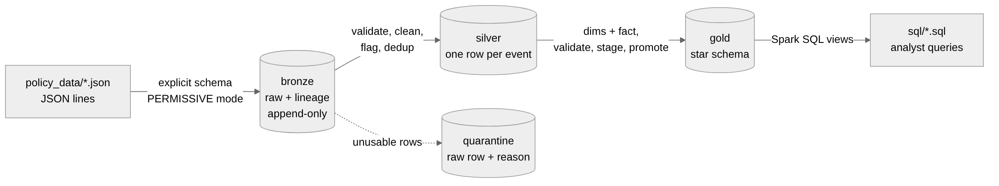
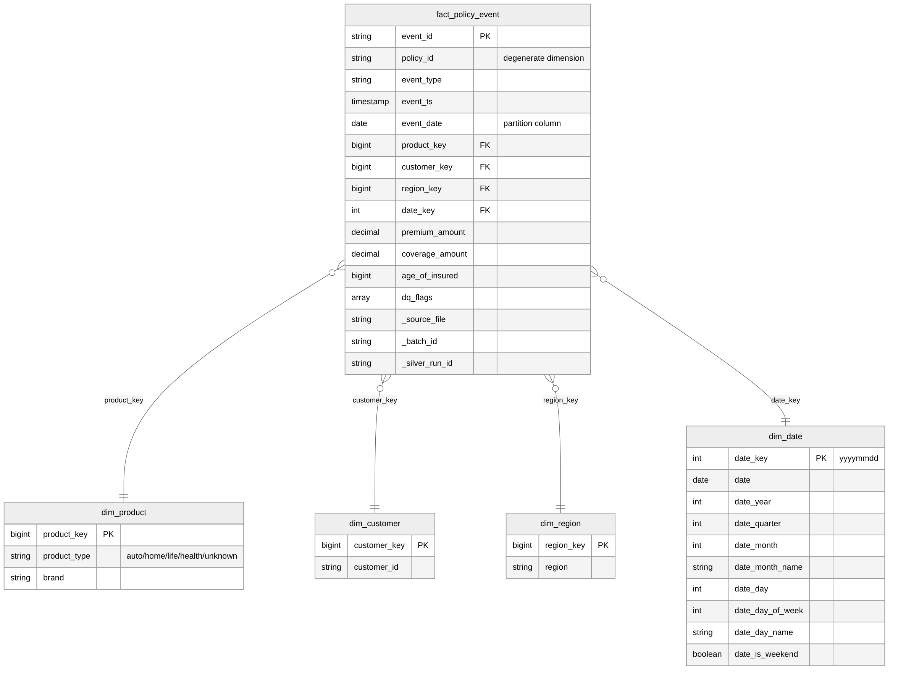
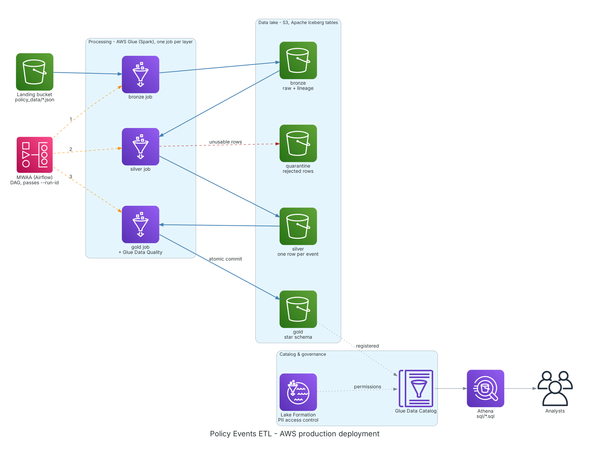

# Policy Events ETL

A PySpark ETL pipeline that turns raw JSON policy events into a cleaned, validated,
queryable **star schema** for downstream reporting and analysis.

---

## Set up

### Running locally with python venv

**Prerequisites:** Python 3.10+ and **Java 17**

```bash
# Java 17 on macOS
brew install openjdk@17
export JAVA_HOME="$(brew --prefix openjdk@17)/libexec/openjdk.jdk/Contents/Home"
export PATH="$JAVA_HOME/bin:$PATH"

# or permanent with
echo 'export JAVA_HOME="$(brew --prefix openjdk@17)/libexec/openjdk.jdk/Contents/Home"' >> ~/.zshrc
echo 'export PATH="$JAVA_HOME/bin:$PATH"' >> ~/.zshrc
source ~/.zshrc

# Python environment
python -m venv venv
source venv/bin/activate
pip install -e ".[dev]"
```

`pip install -e ".[dev]"` installs the project as an editable package (code changes apply
immediately, and `import policy_etl` works from anywhere).

**Run the full pipeline** (raw JSON → bronze → silver → gold):

```bash
python -m policy_etl.etl_pipeline
# optional: --run-id my-run
```

**Run sample queries** against gold data model:

```bash
python -m policy_etl.run_queries                               # all files in sql/
python -m policy_etl.run_queries --query active_customers.sql  # one query
```

**Run the tests** with coverage:

```bash
pytest --cov=policy_etl --cov-report=term-missing
```

All output is written to `data/` (git-ignored, because it is generated and can always be
rebuilt with one command).

### Running with Docker

Docker can be used to run the etl pipeline + testing as well to simplify environment set up.

```bash
docker compose run --rm pipeline   # raw JSON -> bronze -> silver -> gold
docker compose run --rm queries    # run sql/*.sql against gold and print the results
docker compose run --rm tests      # run the test suite with coverage
```

- `./policy_data` is mounted **read-only** at `/app/policy_data`: the container can read the
  raw files but never modify them.
- data is written from the container `/app/data` to
  the project's `data/` folder on your machine and survives the container being removed.
  |

---

## Technology choices

### PySpark rather than pandas

The input is only ~1.3 MB (5,000 events), so pandas would be a better tool for a small project of the scope, I
chose **PySpark** anyway as tt matches my current stack and the target platform allowing it to be easily scaled/productionised via AWS Glue/Databricks.

Two Spark practices followed throughout because they matter at scale:

- **Built-in functions, not Python UDFs.** UDFs push every row through Python and could cause issues when scaling.
- **Explicit schemas.** No schema inference pass over the data, consistent typing for validation checks. In a live process there will be a Data Contract in place specifying these columns and their data types.

### Parquet files

All layers are written as Parquet: an open, columnar format readable by Spark, Athena, Databricks etc.
Iceberg or Delta Lake could be used in production for time travel and MERGE.

### Lakehouse files, not a database

I've used a medallion structure of Bronze/Silver/Gold layers, where each layer will be partitioned, ingest_date for bronze, event_date for silver + gold, with gold representing the final star schema model to reduce redundant data and bronze being the raw unprocessed data.
This is commonly used in Delta or Iceberg solutions.
I thought about using a relational database like Postgres for the final layer for analytical purposes, however I thought due to the volume of data being processed and queried it was out of scope.

In terms of scalability, the volume of data and complexity of reports used for analytics in production environments could cause issues.
Switching to a columnar database such as Redshift and creating materialised views could be a solution however for the scale of this task is not necessary, additionally allowed BI tools such as Tableau to connect directly.

### Portability

"Portable" here means the pipeline runs the same way anywhere, without code changes:

- **Configuration, not hard-coded paths:** every path and the run id are CLI arguments, so
  `./policy_data` locally becomes `s3://landing/policy/` in production.
- **Filesystem-agnostic reads and writes** through Spark (local disk, S3, etc.).
- **Open formats** (Parquet).
- **Packaged as a Python wheel**, which is how both Databricks and Glue run PySpark
- **Optional Docker image** with Java and PySpark pinned, for running locally with no setup.

### Session configuration (`spark.py`)

`spark.sql.session.timeZone=UTC` All timestamps in the source are UTC;

`spark.sql.adaptive.enabled=true`Adaptive query execution: coalesces shuffle partitions and optimises joins at runtime.

`spark.sql.sources.partitionOverwriteMode=dynamic` Session default; full-refresh writes explicitly override it with `static`, silver and gold use static for full refresh

`spark.driver.bindAddress/host=127.0.0.1` For running locally, not applied on a cluster, where executors must reach the driver over the network.

`spark.driver.memory=2g` For running locally, encountered a lack of memory issue when writing many small partitions, coalesce() helped.

---

## Exploring the data

Before designing a solution to process this data some exploration of the data is required to know what you will have to handle, will there be lots of gaps, inconsistent typing or formatting, or obviously invalid values, do you have primary keys already available, how will you model the data, etc.
All of this needs to be thought about first and with that in mind you can have a better idea of what each layer needs to do.

I used Pandas and a jupyter notebook to query quickly query the data, see what columns are available, take mins, maxs, counts, etc.
From this I had a few observations:

1. `policy_type` is a string which could be used as a python dictionary, containing two keys, `type` and `brand`, which requires flattening.
2. `policy_type` has null values for `type` in ~50% of the data. Do we invalidate the whole row or still process into other layers?
3. `coverage_amount` has a negative value in 38 events, invalidate or flag and keep?
4. `age_of_insured` has a negative value in 38 events, < 18 in 105 events. Is <18 a valid age for some policies? It's 'age of insured' not age of customer so can this be mapped onto a customer dim?
5. `premium amount` and `age_of_insured` missing from a number of rows.
6. `policy_id` is not unique and can have multiple `customer_id`
7. No white spacing issues identified
8. Not complete policy history for a given policy_id, some start with cancellations.

Without a data contract or understanding how the data is arriving from upstream, I have decided it is better to to Null and Flag invalid data but keeping the row, and then analysts downstream can decide whether to ignore the flags or not.

## Architecture

### Medallion layers



**Bronze** load the raw data as received into parquet format with ingestion metadata and one row per input line. Partitioned on `_ingest_date` and not loading already read files.

**Silver** Cleans the bronze data, Nulls ineligible values and applies Data Quality flags while retaining the event row, deduplicated on the `event_id`, and finally adds silver metadata. Partitioned on `event_date` which is derived from the `event_timestamp` in the source.

**Quarantine** Rows from Bronze layer that cannot represent an event `_corrupt_record` is not null from the permissive spark read, missing `event_timestamp`, `policy_id`, `customer_id`, or `event_type`. Partitioned on `_ingest_date` and has `_invalid_reason` column added for for investigation. There is nothing in this dataset that requires this layer but would be useful when scaling up and increasing the volumne.

**Gold** A star schema shaped for analysis: dimensions + one fact table, partly normalised to reduce redundancy, one row in the Fact table represents an event, and the dimension tables exist as descriptors of that event, where Foreign Keys in the fact pointing to the PKs in the dims. Partitioned on `event_date` for the fact table; and no partition for the dims due to their small size. Broadcast joins can be used on the Dims when scaling up across a cluster due to their small size.

### One run id through every layer

`etl_pipeline.py` creates a single `run_id` (or accepts `--run-id`) and passes it to all
three stages. It is stored as `_batch_id` in bronze and `_silver_run_id` in silver (carried
into the gold fact), and names gold's staging folder.
Each stage's `process()` also accepts `run_id=None` and generates its own when run
standalone, so stages can be run and tested independently.

Each Layer follows a pattern of reading data from one layer into a dataframe, validating the schema, performing transformations like adding metadata, doing validation on the output dataframe, then writing to the next layer.

---

## Bronze layer

**Goal:** land the raw data as received, add lineage, never fail on bad records, never
duplicate data.

### Raw schema

Bronze uses the types JSON already provides (strings and numbers)

`policy_id`, `customer_id` : string

`event_type`, `region` : string

`event_timestamp` : **string**

`policy_type` : **string** for parsing dict in silver

`premium_amount`, `coverage_amount` : double

`age_of_insured` : bigint

`_corrupt_record` : string from permissive mode, keeps unreadable row but doesn't fail the run.

Every field is nullable (missing keys simply become null). The schema is explicit rather
than inferred: no extra pass over the data to guess types, can handle missing columns, and won't load extras not in contract.

Other modes of handling failures `FAILFAST` kills the entire run;
`DROPMALFORMED` loses the data without knowing..

### Lineage metadata

Every row gets `_source_file` and `_source_file_modified_at` (from Spark's `_metadata`
column), `_ingested_at`, `_ingest_date` and `_batch_id` (the pipeline run id).

### Idempotent, append-only

Before writing, bronze anti-joins the incoming rows against the `_source_file`s already in
bronze, so re-running or retrying after a failure never duplicates rows, and new files are
picked up automatically. This is a simple local version of what Databricks Auto Loader or
Glue job bookmarks do in production.

---

## Silver layer

### Reading bronze: check the schema

`validate_bronze_schema`
checks that every required column exists with the expected type and reports all problems, failing fast before any processing.

### Cleaning the data

There are different ways to clean the data:

### Reject (quarantine)

- The row cannot represent an event. - `_corrupt_record` is not null

- `policy_id`, `customer_id`, `event_type` or `event_timestamp` is null

- Timestamp doesn't parse with the explicit forma

- `event_type` not one of purchase / renewal / claim / cancellation (case-insensitive)

### Fix or standardise

- Parse timestamp `to_timestamp(event_timestamp, "yyyy-MM-dd'T'HH:mm:ss.SSSX")` into `event_ts`, plus `event_date`.

- Parse `policy_type` then `from_json(..., "type STRING, brand STRING")` into `product_type` and `brand`.

- Null impossible values `coverage_amount < 0` (the sentinel) → null; `age_of_insured < 0 or > 120` → null
- Money as decimal `premium_amount` → `decimal(12,2)`, `coverage_amount` → `decimal(14,2)`. Doubles can't represent values like 0.1 exactly, so sums of premiums drift.

### Flag but keep

`dq_flags` is an array (`array_compact` removes the empty entries), so analysts can count or
exclude affected rows per issue, these flags are:

- product_type_missing
- invalid_age_of_insured : nulled if negative, value kept if <18 as might be valid.
- negative_coverage_amount
- premium_missing

### Generate Event id and deduplication

There is no single column that can be used as event_id so one can be made by concatenating the identifiers as a compound key, like policy_id, customer_id ...

```python
event_id = sha2(policy_id | customer_id | event_ts (normalised) | lower(event_type), 256)
```

- A random UUID changes every run, so you can't deduplicate,
  `MERGE` or join on it. A hash of the business key gives the same event the same id on
  every run, from whichever file it came.
- Timestamp is consistently formatted in silver,
- `concat_ws` skips nulls, which is safe only because validation has already rejected null
  keys; that's one reason this runs after the split.

Deduplication keeps the **most recently ingested** version per `event_id` using a window
(`row_number` ordered by `_ingested_at` desc, then `_source_file` desc as a tie-break).

### Metadata and final columns

- **Kept (lineage):** `_source_file`, `_source_file_modified_at`, `_batch_id`, `_ingested_at`.
- **Added:** `_silver_run_id`, `_silver_processed_at`.
- **Dropped:** `_corrupt_record` (it lives in quarantine), the raw `event_timestamp`
  (replaced by `event_ts`), the raw `policy_type` (replaced by `product_type` and `brand`),
  `_ingest_date` (silver is partitioned by `event_date`).

### Writing silver

- Partitioned by `event_date`, not ingest date: analysts filter by when the event happened.
- Repartitioned by `event_date` before the write, to prevent 1000s of tiny files being written and running into memory issues.
- Don't need to daily partitions at this scale, but in production `event_date` is a standard choice. At production scale on Delta, liquid clustering is the
  modern alternative.

### Caching

The DataFrame is cached after reading and parsing, and again after the cleaning steps, so
each `count()` and write reuses computed data instead of re-running the pipeline from bronze.
Caching 5,000 rows costs a few MB.

---

## Gold layer: the data model

### Star schema


| Table | Rows (this data) | Contents |
| ------------------- | ---------------- | ------------------------------------------------------ |
| `fact_policy_event` | 5,000 | One row per event: keys, measures, `dq_flags`, lineage |
| `dim_product` | 20 | 16 type × brand combinations + 4 `unknown` × brand |
| `dim_customer` | 3,344 | One row per customer |
| `dim_region` | 4 | North, South, East, West |
| `dim_date` | 366 | One row per event date, with calendar attributes |

### Why a star schema, and how it reduces redundancy

- Descriptive attributes live on dim tables to reduce repetition, using keys to join them
- Simple schema, not heavily normalised for quick writes of transactions, fewer joins so more efficient for analysis.
- Honest caveat: Parquet's dictionary encoding already makes repeated strings cheap, so the
  main gains are consistency and maintainability. Query speed comes mostly from
  partitioning and column pruning.

### Grain and modelling decisions

- **Grain:** one row per policy event. Fact row count equals silver row count by
  construction (the fact only adds key columns; it never filters or joins).
- **`event_date` stays on the fact** alongside `date_key` because it's the partition column:
  a small redundancy in exchange for partition pruning.
- **`dq_flags` and lineage columns are carried into the fact** so analysts can filter on data
  quality and trace any row to its source file and run.
- At this scale, some dims are not very descriptive, dim_customer just has customer_id. In a production environment you would have customer name, age, email etc, and having a dim would make more sense. Likewise with brand and product type, with real data you might make a dim for each with supplementary data.
- policy_id can have multiple customer_ids so coudn't be moved to a dim, could use a policy_holder dim with primary, secondary holders, however would need more context.

### Keys: deterministic, defined once

Keys for each dim: product, region, customer were generated using their natural keys, for date the timestamp as an int was used.

- **Why not `row_number()` / `monotonically_increasing_id()`:** those numbers change between
  runs, Hashing the natural key gives the same value the same
  key on every run.
- **Each key is defined in exactly one function** (`product_key()`, `region_key()`,
  `customer_key()`, `date_key()`), used by the dimension as its primary key _and_ by the fact
  as its foreign key.
- **`xxhash64` returns a bigint:** integer keys join faster and smaller than strings.
- **Unkown key:** Coalescing to `unknown` in
  both the key and the dimension row means every fact row joins, and analysts see an
  explicit `unknown` bucket.

### Validation before anything is written

`validate_gold()` checks the star schema and raises listing **every** problem:

- each dimension's primary key is unique;
- **no orphan foreign keys**: for each fact key, a `left_anti` join to its dimension returns
  0 rows (null keys count as orphans);
- the fact has exactly one row per silver event.

---

## Assumptions

| **Active policy** | A policy's status is set by its most recent purchase, renewal or cancellation. Claims don't change status. Active = that latest event is a purchase or renewal.

| **Missing policy type** | A genuine event with an unknown attribute (see "Aren't the 631 typeless renewals an overcount?" in the Design Q&A): reported as `unknown`, never dropped or guessed.

| **Under-18 ages** | Possibly genuine (children on health/life policies): kept and flagged. Nulling them is a business-rule decision. |

| **Ages over 120 / negative** | Impossible: nulled and flagged.

| **Coverage ≤ 0 / sentinel** | Not a real amount: nulled and flagged.

| **Duplicates** | Same policy, customer, event type and timestamp = same event; the latest ingested version wins.

| **Timestamps** | UTC, ISO-8601 with milliseconds; anything else is rejected.

| **Landing location** | Files land at a stable path (as in a landing bucket); bronze identifies ingested files by path.

---

## Scope decisions

The brief invites limiting scope; these are the deliberate choices and the reasoning.

**Batch only** The data arrives as files; batch is simpler to reason about, test. **PROD**: Structured Streaming / Auto Loader with `trigger(availableNow=True)` |
**Full refresh of silver and gold** Simple and idempotent, quick to run as this scale: **PROD** Incremental: read only new bronze batches and `MERGE` into Delta/Iceberg on `event_id`.

**Daily `event_date` partitions** Matches the main query pattern; Over-partitioned at this volume **PROD**: Size partitions to the data, or liquid clustering / Iceberg hidden partitioning

**No orchestrator** A single `etl_pipeline.py` runs the stages in order with a shared run id. No need to orchestrate at this scale **PROD** Use Airflow / Databricks Workflows one task per stage with dependencies.

**Distinct-date `dim_date`** Identical to a full calendar on this data **PROD** Generated calendar covering every day

**No dashboard / BI layer** not in scope **PROD** BI tool on gold, or analytical DB.

## Testing strategy

**22 tests, ~87% coverage** (`pytest`; the only untested lines are the CLI `main()` functions).
A session-scoped local `SparkSession` in `tests/conftest.py` uses the pipeline's own
`get_spark()`. Tests are deliberately few: each documents one rule using a handful of
hand-built rows (`bronze_row(**overrides)` / `silver_row(**overrides)` change only the field
under test), and they build their own inputs, so they don't depend on `policy_data/`.

| File               | Covers                                                                                                                                                                                          |
| ------------------ | ----------------------------------------------------------------------------------------------------------------------------------------------------------------------------------------------- |
| `test_bronze.py`   | Corrupt lines kept and flagged; missing fields → null; lineage; re-runs skip ingested files                                                                                                     |
| `test_silver.py`   | Schema check; timestamp parsing; reject rules and precedence; `policy_type` parsing; DQ flags then nulling; decimals; event id; dedup; end to end incl. row conservation and idempotent re-runs |
| `test_gold.py`     | `unknown` product; date attributes; no orphan foreign keys; validation reports every problem; **a simulated write failure leaves live gold untouched**                                          |
| `test_pipeline.py` | One run id flows through bronze, silver and gold; row counts match across layers                                                                                                                |

**Next:** golden-dataset tests asserting the `.sql` files return known answers; bronze edge
cases (missing path, unknown fields, empty or gzipped files); tests for the metrics checks;
ruff and mypy in CI.

---

## Productionisation and scaling



**Deployment unit: a Python wheel.** Databricks and Glue both run PySpark from a wheel on
their own Spark runtime (`python -m build` → `dist/policy_etl-0.1.0-py3-none-any.whl`).
Business logic is already in pure functions with every path and the run id as parameters.
Two changes before deploying: only set `local[*]` when running locally (a master set in code
overrides `spark-submit`), and make PySpark an optional dependency, since the platform
provides its own.

| Concern                                     | Databricks (target)                                                  | AWS Glue (alternative)                                                                  |
| ------------------------------------------- | -------------------------------------------------------------------- | --------------------------------------------------------------------------------------- |
| Deploy and run                              | Asset Bundles from CI; Workflow with a `python_wheel_task` per stage | Wheel on S3 via `--additional-python-modules`; Glue job per stage                       |
| Table format                                | Delta in Unity Catalog                                               | Iceberg in the Glue Data Catalog                                                        |
| Atomic publish (replaces staging + promote) | Each write is an atomic commit                                       | Atomic metadata-pointer swap; Write-Audit-Publish branches = stage → validate → publish |
| Rollback                                    | Time travel / `RESTORE TABLE ... VERSION AS OF`                      | `rollback_to_snapshot` / time travel                                                    |
| Incremental loads                           | `MERGE INTO ... ON event_id` (corrections, late data)                | `MERGE INTO` on Iceberg                                                                 |
| Skip already-ingested files                 | Auto Loader                                                          | Job bookmarks                                                                           |
| Data-quality gate                           | Expectations / checks before publishing                              | Glue Data Quality (DQDL)                                                                |
| Access control (PII)                        | Unity Catalog                                                        | Lake Formation                                                                          |

Multi-table atomicity is still not automatic on either (Iceberg with a Nessie catalog is the
exception): write dimensions then the fact, record each table's version per run, and restore
all of them if a later step fails.

**Orchestration:** Airflow, Databricks Workflows, one task per layer with
retries and alerts, passing the orchestrator's run id as `--run-id` for lineage.

**Scaling:** more data means more executors, broadcast dimension joins and AQE
already suit large data. Add incremental `MERGE` loads and size files to ~100 MB–1 GB
(compaction or liquid clustering).

**Monitoring:** turn the logged row counts and DQ flag counts into metrics with alerts (e.g.
invalid rate above 5%, a jump in `product_type_missing`, a column suddenly 100% null), check
row conservation per run, and detect schema drift (PERMISSIVE mode drops unknown fields).

**PII and governance:** `customer_id` and `age_of_insured` are personal data: access
controls, masking where raw identifiers aren't needed, and retention/deletion policies.

**CI/CD:** lint, type-check and test on every merge, build the wheel once and promote the same
artefact dev → staging → prod; Terraform for infrastructure; credentials from IAM roles or
service principals, never in code.

---

## Known limitations

- **A corrected file re-sent under the same name is skipped** by bronze. Keying on path plus
  `_source_file_modified_at`, or Auto Loader / Glue bookmarks, would handle it.
- **Unknown fields in the source are dropped silently** by PERMISSIVE mode; a renamed field
  would become all-null rather than raising an error.
- **The gold promote step is near-atomic per table, not across all five**; a crash in the
  fraction of a second it takes could mix old and new tables. Re-running gold fixes it.
- **`get_spark()` always sets `local[*]`** and **PySpark is a hard dependency**: both need
  changing before deploying to a cluster
- **Daily partitions are over-partitioned** for the current volume.
